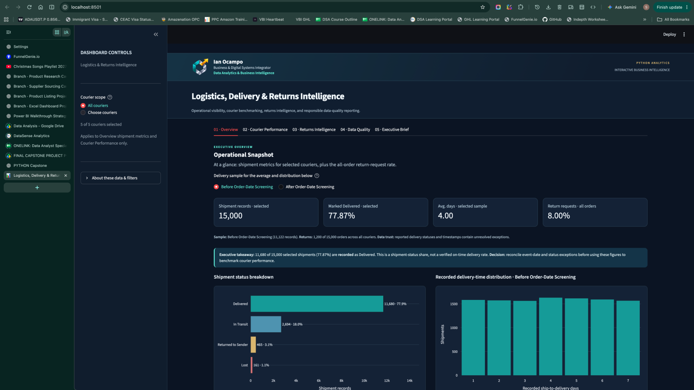
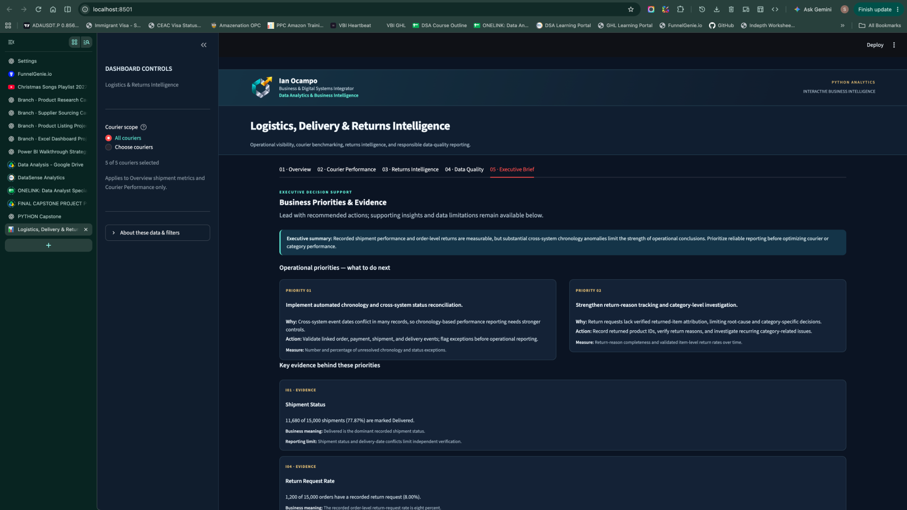

# Logistics, Delivery & Returns Intelligence

Python analytics case study by **Ian Ocampo**, Business & Digital Systems Integrator — Data Analytics & Business Intelligence.

**Project focus:** Understand recorded shipment outcomes, shipping-to-delivery lead times, courier patterns, return requests, and the effect of source-data reliability on interpretation.

**Portfolio:** https://data.ianocamposystems.com

## At a glance

| Scope | Verified outcome |
| :--- | :--- |
| **Shipment coverage** | 15,000 orders and 15,000 shipment records |
| **Recorded Delivered status** | 11,680 shipments (77.87%) |
| **Recorded delivery duration** | 4.00 days, average across 11,122 eligible observations |
| **Return requests** | 1,200 orders (8.00% of all orders) |
| **Quality verification** | 85 / 85 documented validation checks passed |
| **Delivery** | Six-page Streamlit analytical dashboard and executive report |

These are descriptive measures from the supplied source records, **not live operational service-level commitments**.

## Dashboard preview

**01 — Executive overview**  


**06 — Data & Methodology**  


*Screenshots: local six-page dashboard captured on November 1, 2026. Public deployment will be linked here after independent live verification.*

## Interactive dashboard

This public portfolio demonstration uses supplied synthetic source data. Six dashboard pages:

1. Overview
2. Courier Performance
3. Returns Intelligence
4. Data Quality
5. Executive Brief
6. Data & Methodology

### Run locally

From the project root with Python environment activated:

```bash
python -m pip install -r requirements.txt
python -m streamlit run logistics_delivery_dashboard.py
```

The dashboard uses bundled `Public_Data/` files for public-data fallbacks. No private account connection is required. The optional remote logo source has a bundled fallback at `Assets/data_port_logo.png`.

### Deploy to Streamlit Community Cloud

Create a public GitHub repository and push the files in **this folder**. In Streamlit Community Cloud select that repository and set main file to `logistics_delivery_dashboard.py` at the repository root. Cloud dependency installation uses `requirements.txt` at the root. Deployments, public URL, and network behavior must be tested after publishing; they are not verified by this local package.

## Python analysis and reproducibility

- `Notebook/Logistics_Analysis_Documented.ipynb` — main Python notebook, including Steps 107–109 and saved validation results.
- `Notebook/Source_Data_Audit.ipynb` — original input-data assessment.
- `Data/Raw/` — original seven project CSVs to reproduce notebook execution.
- `Outputs/Cleaned_Data/` — seven prepared working tables.
- `Outputs/Dashboard_Data/` — four dashboard tables generated by Step 106.
- `Outputs/Cleaning_Evidence/` — cleaning register, missing-data policy, and 85-check Step 109 validation.
- `Outputs/Charts/` — five Matplotlib figures.
- `Public_Data/` — public source, prepared reference, chart, and export bundles used for open dashboard downloads.
- `Docs/Executive_Report.pdf` — accompanying executive case study report.
- `Docs/One_Page_Insights_Summary.pdf` — one-page executive insights and recommended decisions.
- `Executive_Summary.txt` — concise executive summary in the project submission format.

For notebook dependencies use `python -m pip install -r requirements-analysis.txt` in an appropriate environment, then execute cells sequentially. The capstone notebook was developed in an established local environment; do not confuse the root dashboard requirements with the full notebook environment.

## Interpretation boundaries

- Recorded *Delivered* status is **not** a verified on-time delivery SLA.
- The 8.00% rate refers to **orders with a return request**, not completed returns.
- **Home & Kitchen's 8.64%** is the percentage of orders containing this category with a request (352 / 4,076), **not** the confirmed item-level return rate.
- Date and cross-system status conflicts are recorded as review flags; the report does not claim operational failures or proven courier superiority.
- Source-data and evidence CSVs are intentionally public for portfolio reproducibility. Do not replace them with real client data without explicit permission and appropriate security controls.

## Reporting and verification

Steps 107–109 in the notebook export cleaned CSVs, record the six required cleaning operations, and produce `Outputs/Cleaning_Evidence/step109_final_validation.csv` (85 checks recorded as PASS in the uploaded project evidence). This repository is a public portfolio demonstration, not a live client production integration.
