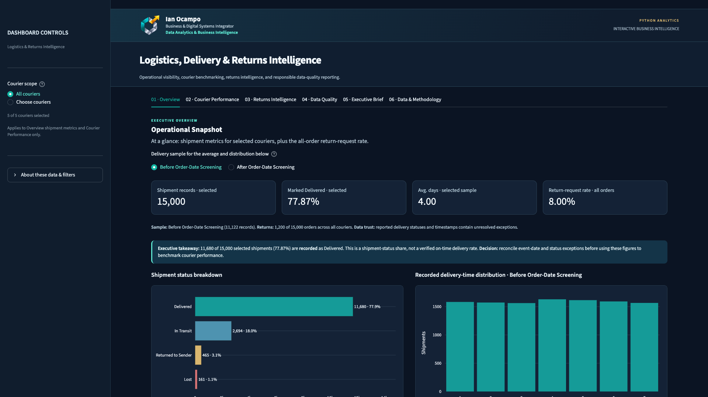
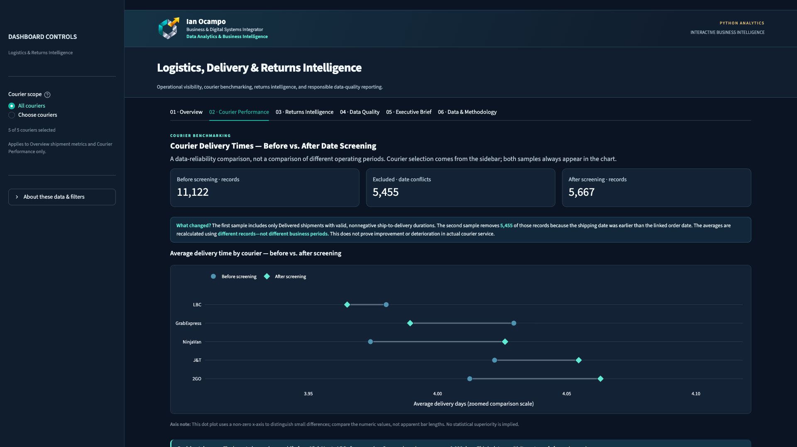
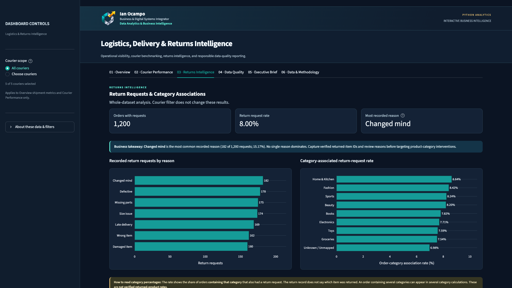
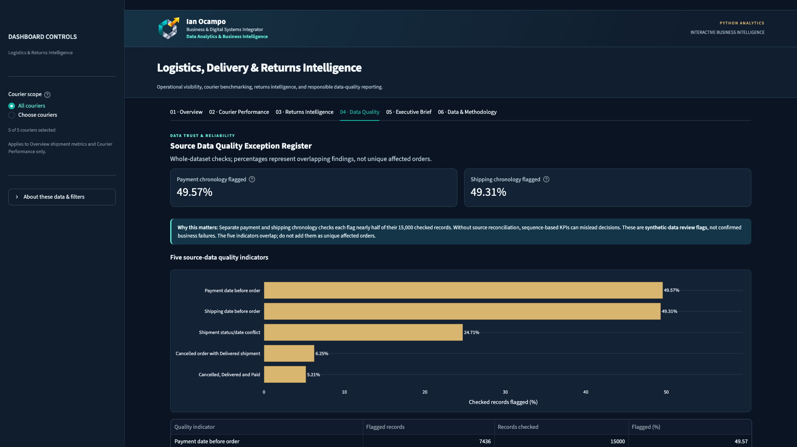
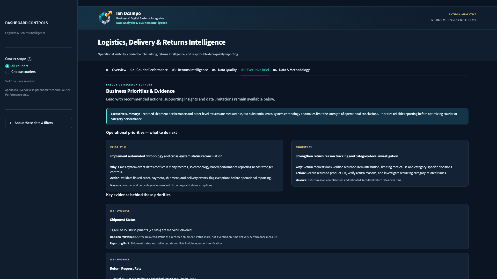
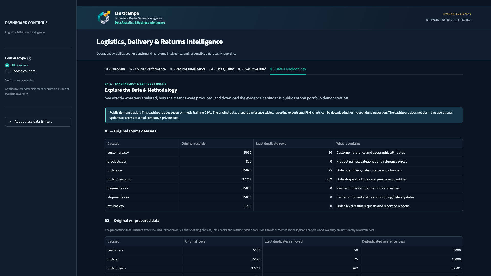

# Logistics, Delivery & Returns Intelligence

**From 15,000 shipment records to clearer delivery and returns decisions.**

An end-to-end **Python analytics case study** combining seven synthetic datasets, documented cleaning and data-quality validation, and a **six-page interactive Streamlit dashboard**. The project examines what the records show, what they cannot reliably prove, and which operating questions deserve action.

**Ian Ocampo** · Business & Digital Systems Integrator · Data Analytics & Business Intelligence

[**Dashboard Gallery**](#six-page-dashboard-gallery) · [**Executive Case Study (PDF)**](Docs/Executive_Report.pdf) · [**One-Page Insights (PDF)**](Docs/One_Page_Insights_Summary.pdf) · [**Python Notebook**](Notebook/Logistics_Analysis_Documented.ipynb) · [**Data Analytics Portfolio**](https://data.ianocamposystems.com)

*Actual Streamlit dashboard preview — Page 01 / 06. Click to view full resolution. The public interactive app has not yet been deployed.*

### The business question

> **How well are we delivering, and what drives recorded return requests?**

**Value of the work:** A clear, inspectable view of operational outcomes, courier comparisons, return-request patterns, and critical source-data limitations—with evidence-backed recommendations instead of unsupported performance claims.

---

## Executive snapshot

| Indicator | Verified project finding |
| :--- | :--- |
| **Order & shipment coverage** | **15,000** distinct orders; **15,000** shipment records |
| **Recorded Delivered status** | **11,680 / 15,000 (77.87%)** of shipments |
| **Average recorded delivery duration** | **4.00 days**, across **11,122** eligible records before chronology screening |
| **After chronology screening** | **4.02 days**, across **5,667** records |
| **Orders with return requests** | **1,200 / 15,000 (8.00%)** |
| **Source-data preparation** | **387** exact duplicate rows removed from **89,888** source rows |
| **Documented data-quality validation** | **85 / 85** checks recorded as PASS |

> **Interpretation matters:** A recorded *Delivered* status is not proof of on-time delivery. The 8.00% metric measures **orders with a return request**, not completed or item-specific returns. These are historical synthetic-data observations, not live business KPIs.

## Six-page dashboard gallery

Six **clean 1920 × 1080 captures** taken from the actual Streamlit application. Click an image to inspect its full-resolution PNG. These are previews, **not yet a publicly deployed interactive app**.

### 01 — Overview | Operational snapshot

The **full-width executive overview screenshot appears at the top of this README**. [Open the full-resolution overview](Assets/dashboard_01_overview_1920x1080.png). The overview makes its delivery-duration screening sample explicit and separates recorded shipment status from verified service-level performance.

| **02 — Courier Performance** | **03 — Returns Intelligence** |
| :--- | :--- |
|  |  |
| Compares courier averages across different **data screening cohorts**, not different time periods. | Examines recorded request reasons and category **associations**, not verified returned items. |

| **04 — Data Quality** | **05 — Executive Brief** |
| :--- | :--- |
|  |  |
| Documents overlapping date and status conflicts before conclusions are drawn. | Connects findings to two practical, measurable improvement priorities. |

### 06 — Data & Methodology | Reproducibility and evidence

Makes the source tables, preparation choices, KPI definitions, and public evidence downloads accessible from the dashboard.

## Findings that influence decisions

**1. Confirm event chronology before using delivery metrics as operating targets.** The source contains **7,436** payment-before-order flags, **7,397** shipping-before-order flags, and **3,707** shipment-status/date conflicts. These checks overlap; their counts must not be added together to estimate unique affected orders.

**2. Be careful when comparing couriers.** The baseline recorded-duration sample contains **11,122** eligible shipments averaging **4.00 days**; stricter chronology screening retains **5,667** averaging **4.02 days**. Courier comparisons are sensitive to which records are eligible. This does not demonstrate courier superiority or a performance improvement.

**3. Improve return attribution before changing category strategy.** There are **1,200** orders with return requests (**8.00%**). The most common recorded reason is **Changed mind** (**182** requests; **15.17%** of requests). **Home & Kitchen** appears in **352 / 4,076 (8.64%)** orders containing that category with a return request; this is **not** an item-level returned-product rate.

### Recommended priorities

| Priority | Proposed action | Suggested measure |
| :--- | :--- | :--- |
| **01 · Data reliability** | Reconcile order, payment, shipment and delivery timestamps/statuses before operational reporting. | Count and rate of unresolved chronology/status exceptions |
| **02 · Returns intelligence** | Capture verified returned-item identifiers, reasons and outcomes to support item-level investigations. | Completeness of item attribution and validated item-level return metrics |

These are **recommendations derived from the demonstration data**, not claims of implemented process changes or realized savings.

## Project structure & evidence

| Location | Purpose |
| :--- | :--- |
| [**Dashboard application**](logistics_delivery_dashboard.py) | Six-page interactive Streamlit app with sidebar courier controls |
| [**Primary documented notebook**](Notebook/Logistics_Analysis_Documented.ipynb) | Python workflow, transformation steps and final validation evidence |
| [**Source-data audit notebook**](Notebook/Source_Data_Audit.ipynb) | Initial assessment of the seven source tables |
| [**Raw CSVs**](Data/Raw) · [**Cleaned CSVs**](Outputs/Cleaned_Data) | Seven source datasets and seven cleaned working tables |
| [**Data quality evidence**](Outputs/Cleaning_Evidence) | Rules, reconciliation, missing-value decisions and 85-check validation export |
| [**Dashboard data tables**](Outputs/Dashboard_Data) · [**Public evidence bundle**](Public_Data) | Prepared analytic tables and inspectable public sources/exports |
| [**Five analytical charts**](Outputs/Charts) · [**Six-page gallery assets**](Assets) | Standalone visualization evidence and dashboard previews |
| [**Executive Case Study (PDF)**](Docs/Executive_Report.pdf) | Executive-facing narrative, findings, methodology and recommendations |
| [**One-Page Insights (PDF)**](Docs/One_Page_Insights_Summary.pdf) · [**Executive Summary (TXT)**](Executive_Summary.txt) | Condensed project takeaways |

### Analytical workflow

**7 source CSVs → source audit → cleaning and duplicate reconciliation → business metrics and quality flags → 85 documented validation checks → prepared dashboard tables → six-page Streamlit dashboard → executive recommendations**

**Technology:** Python · pandas · Jupyter Notebook · Matplotlib · Plotly · Streamlit · CSV evidence exports · Git/GitHub.

## Run the dashboard

From the repository root in a Python environment:

~~~bash
python -m pip install -r requirements.txt
python -m streamlit run logistics_delivery_dashboard.py
~~~

Streamlit uses the project-relative bundled datasets and public-data fallbacks. The application displays **synthetic demonstration data**, requires no private credentials and does not edit source records.

For the **analysis notebooks**, use [requirements-analysis.txt](requirements-analysis.txt) and execute the documented workflow in order. The main notebook was developed in an existing workstation project folder; if running it from a fresh clone, review the first cell's local project-root fallback and point it to the cloned repository before rerunning the full notebook. The dashboard itself uses project-relative paths.

### Deploy later to Streamlit Community Cloud

The repository contains the app entry point **logistics_delivery_dashboard.py** and root-level **requirements.txt**. A public Streamlit Cloud URL will be added **only after deployment and live testing** across all six pages.

## Data boundaries & attribution

- Data is **synthetic training/demo data**, not a real client's private information or a live production system.
- Shipment-status shares are not independently verified on-time delivery measures.
- Return-request rates are **order-level** and should not be reported as confirmed item returns.
- Source quality indicators are overlapping review flags, not proven operational failures.
- The README and screenshots show the **top viewport** of each dashboard page; additional content may extend below the fold.
- See [the executive case study](Docs/Executive_Report.pdf), [the one-page summary](Docs/One_Page_Insights_Summary.pdf) and [the data methodology guide](Public_Data/DATA_GUIDE.md) for supporting explanations.

---

**Prepared by Ian Ocampo**  
Business & Digital Systems Integrator · Data Analytics & Business Intelligence  
[Explore the Data Analytics Portfolio](https://data.ianocamposystems.com)
